# 🍽️ Comandix

[](https://github.com/alexandrefgs/comandix/actions/workflows/ci.yml)


Sistema de comandas para restaurantes, com cardápio, mapa de mesas, fila da cozinha, divisão de conta, taxa de serviço por garçom, caixa com conferência, pagamentos por pessoa, histórico de auditoria e emissão de NFC-e (simulada).

Full-stack: **API em ASP.NET Core** e **front-end em Angular** com renderização no servidor, tema claro e escuro, e telas pensadas para o celular do garçom.

## Telas

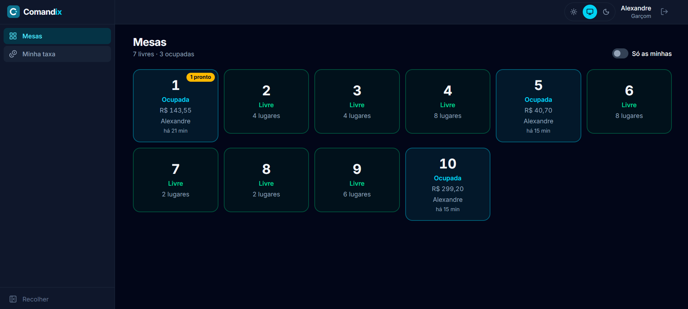

| Comanda | Divisão da conta |
|---|---|
| 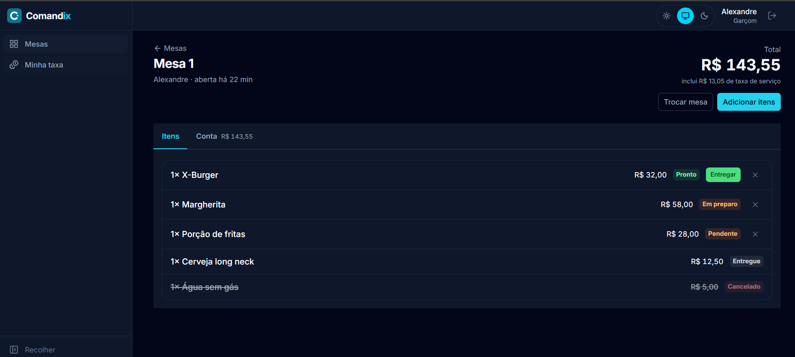 | 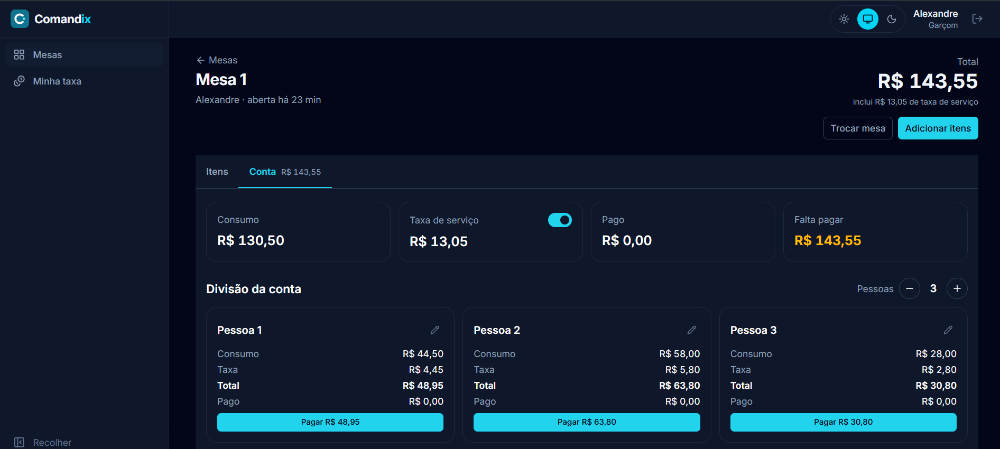 |

| Quem consumiu cada item | Histórico da mesa |
|---|---|
| 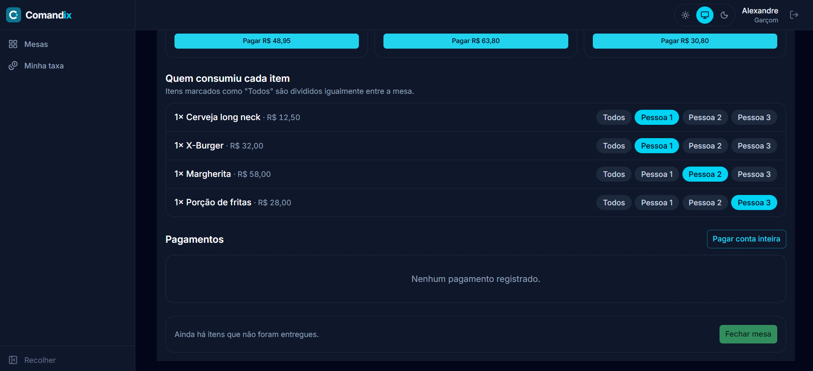 | 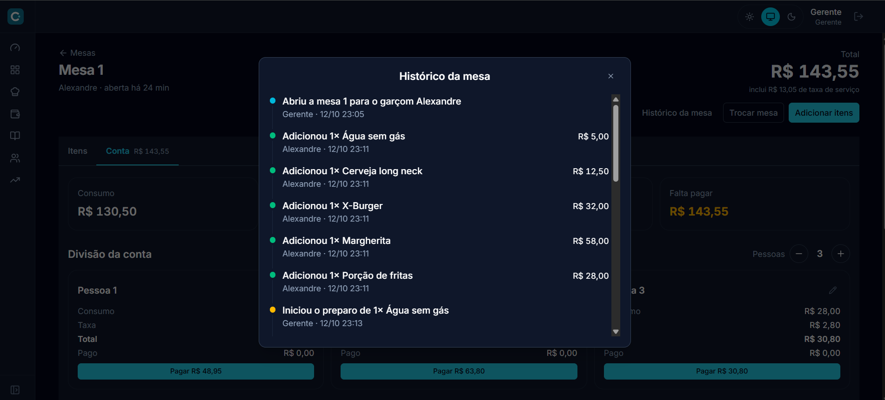 |

<details>
<summary><strong>Mais telas</strong></summary>

### Acesso

| Gerente e caixa | Garçom e cozinha | PIN do crachá |
|---|---|---|
| 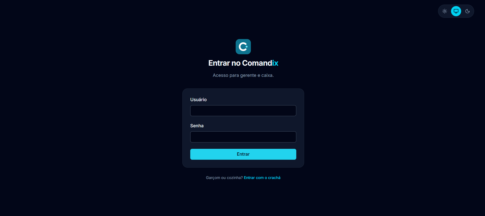 | 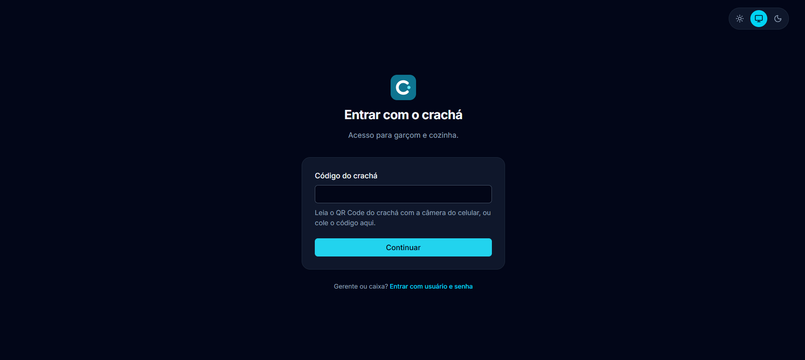 | 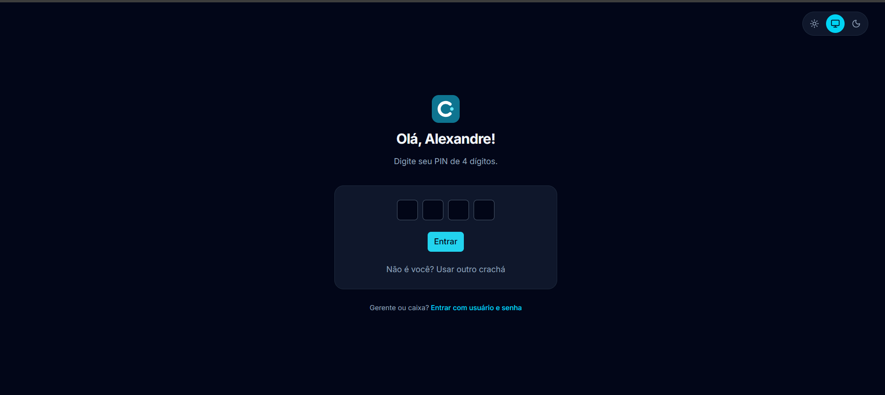 |

### Histórico

| Cancelamentos | Preparo e entrega |
|---|---|
| 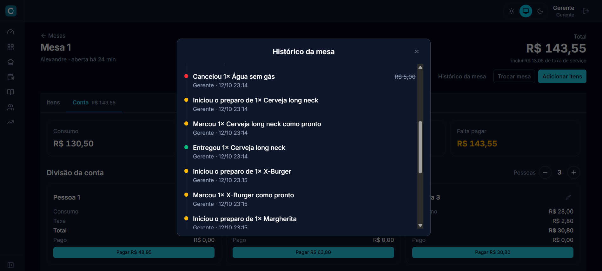 | 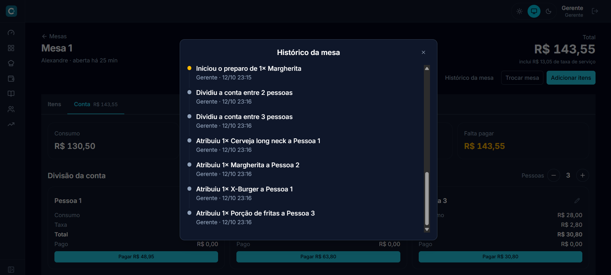 |

### No celular

<p align="center">
  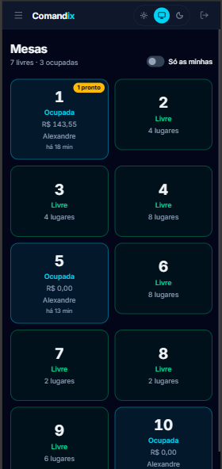
</p>

</details>

## Funcionalidades

### Salão e cozinha

- **Mapa de mesas:** livres e ocupadas em cartões, com o valor consumido, o garçom, há quanto tempo a mesa está aberta e um aviso de itens prontos para entregar, atualizado automaticamente
- **Comandas:** uma por mesa, aberta por um garçom, com itens e observações
- **Pedido em rascunho:** o garçom monta o pedido inteiro da mesa (com busca e categorias) e envia para a cozinha de uma vez
- **Atendimento compartilhado:** qualquer garçom pode lançar itens em qualquer mesa, mas a taxa de serviço vai sempre para quem abriu a comanda
- **Troca de mesa:** a comanda muda de mesa com tudo o que já foi pedido e pago, liberando a mesa anterior
- **Preço congelado:** o item guarda o preço do momento do pedido; mudanças no cardápio não afetam comandas abertas
- **Fila da cozinha:** itens seguem o fluxo Pendente → Em preparo → Pronto → Entregue
- **Cardápio:** categorias e produtos, com controle de disponibilidade
- **Mesas e funcionários:** cadastro, ativação e cargos (garçom, cozinha, caixa, gerente)

### Conta e pagamentos

- **Divisão de conta:** defina quantas pessoas, dê nome a cada uma e marque quem consumiu cada item; itens sem atribuição são divididos entre todos
- **Taxa de serviço:** 10% por padrão, calculada individualmente sobre o consumo de cada pessoa, podendo ser dispensada
- **Pagamentos por pessoa ou da mesa inteira:** dinheiro (com cálculo de troco), Pix, débito ou crédito
- **Estorno:** pagamentos lançados errado podem ser estornados com motivo; o registro original é mantido
- **Fechamento seguro:** a comanda só fecha com todos os itens entregues e saldo zerado
- **Relatório mensal:** total de taxa de serviço por garçom, considerando o fuso de Brasília

### Caixa

- **Caixa do dia:** abertura com fundo de troco e fechamento com conferência, mostrando a diferença entre o dinheiro esperado e o contado
- **Sangria e suprimento:** retiradas e reforços de dinheiro na gaveta, com motivo obrigatório
- **Resumo do caixa:** total vendido por forma de pagamento, calculado diretamente no banco

### Histórico de auditoria

- **Toda ação na comanda é registrada:** abertura, itens adicionados, preparo, entrega, cancelamentos, divisão, taxa, troca de mesa, pagamentos, estornos e fechamento
- **Quem fez e quando:** cada registro guarda o nome do funcionário e o horário, gravados na mesma transação da ação
- **Imutável:** os registros nunca são alterados nem apagados, e o nome fica gravado no evento, mesmo que o funcionário mude de nome ou seja desativado
- **Linha do tempo para o gerente:** consultada direto na tela da comanda

### Nota fiscal

- **NFC-e simulada:** emitida automaticamente no fechamento da comanda, com numeração sequencial por série
- **Chave de acesso de 44 dígitos:** montada com a estrutura oficial (UF, ano/mês, CNPJ, modelo 65, série, número, código numérico) e dígito verificador calculado pelo módulo 11
- **Pronta para emissão real:** o emissor é desacoplado pela interface `IEmissorNotaFiscal`; trocar pela integração com um provedor exige apenas uma nova implementação e uma linha de configuração
- Toda nota simulada é marcada como **"SIMULAÇÃO - DOCUMENTO SEM VALOR FISCAL"**

### Acesso e segurança

- **Autenticação com JWT:** gerente e caixa entram com usuário e senha; garçom e cozinha com o crachá (QR Code) + PIN de 4 dígitos
- **Crachá como link:** o QR Code abre o sistema já na tela de PIN, por qualquer câmera de celular; o código vai no fragmento da URL (`#`), que nunca é enviado ao servidor
- **Permissões por cargo:** cada endpoint libera apenas os cargos que fazem sentido, e o menu de cada funcionário mostra só as áreas do cargo dele
- **Proteção das credenciais:** senhas e PINs com hash PBKDF2, código do crachá com SHA-256, bloqueio após 5 PINs errados e regeneração do crachá em caso de perda

## Perfis de acesso

| Área | Gerente | Garçom | Cozinha | Caixa |
|---|:---:|:---:|:---:|:---:|
| Consultar cardápio, mesas, comandas e caixa atual | ✅ | ✅ | ✅ | ✅ |
| Cadastrar cardápio, mesas e funcionários | ✅ | | | |
| Marcar produto disponível/indisponível | ✅ | ✅ | ✅ | |
| Abrir comanda, lançar itens, trocar mesa, dividir conta | ✅ | ✅ | | |
| Fila da cozinha e avanço de status | ✅ | ✅ | ✅ | |
| Registrar pagamento, fechar e cancelar comanda | ✅ | ✅ | | ✅ |
| Consultar nota fiscal | ✅ | ✅ | | ✅ |
| Estornar pagamento | ✅ | | | ✅ |
| Abrir e fechar caixa, sangria e suprimento | ✅ | | | ✅ |
| Histórico de ações da comanda | ✅ | | | |
| Relatório de taxa de serviço | ✅ | só o próprio | | |

Quando o garçom abre uma comanda, ela fica no nome dele, vindo do token. O gerente pode abrir uma mesa em nome de qualquer garçom.

## Tecnologias

**Back-end**


**Front-end**


**Infraestrutura**


## Arquitetura

```
Comandix.Domain          → entidades, regras de negócio, exceções de domínio, contrato do emissor fiscal
Comandix.Infrastructure  → EF Core, mapeamentos, migrations, emissor de NFC-e simulado
Comandix.Api             → controllers, DTOs, autenticação, tratamento de erros, histórico de auditoria
Comandix.Domain.Tests    → testes de unidade das regras de negócio
Comandix.Api.Tests       → testes de integração da API com banco real
comandix-web             → front-end em Angular
```

### Back-end

As regras de negócio ficam no domínio (por exemplo, `Comanda.Fechar()` impede fechar com itens não entregues ou saldo pendente, e `Mesa.Atualizar()` impede editar uma mesa ocupada). Violações viram `DomainException`, que um handler global converte em respostas `400` no padrão `ProblemDetails` (RFC 9110).

A API é protegida por padrão: todo endpoint exige autenticação, e apenas o login é público.

Garantias importantes também ficam no banco, com índices únicos filtrados: uma comanda aberta por mesa, um único caixa aberto por vez e numeração de notas fiscais sem repetição.

### Front-end

- **Angular 22 com componentes standalone e signals** para o estado das telas
- **Renderização por rota:** a página inicial e o login são pré-renderizados no build (carregam instantaneamente e são indexáveis); a área interna roda só no navegador, onde fica o token
- **Carregamento sob demanda:** o código de cada área só é baixado quando a pessoa entra nela
- **Menu, rotas e permissões a partir de uma única lista:** um item de menu nunca aparece para quem não pode abri-lo, e nenhuma rota fica desprotegida por esquecimento
- **Interceptor HTTP:** adiciona o token em toda chamada à API e leva de volta ao login quando a sessão expira
- **Erros da API em português:** como todo erro sai no formato `ProblemDetails`, uma função só exibe qualquer mensagem do back-end
- **Tema claro, escuro ou do sistema,** sem piscar ao carregar, e layout responsivo com menu lateral recolhível no computador e gaveta no celular

## Nota fiscal: simulação e emissão real

O emissor é escolhido pela configuração `NotaFiscal:Modo` no `appsettings.json`:

```json
"NotaFiscal": {
  "Modo": "Simulacao",
  "Serie": 1,
  "CodigoUf": 42,
  "CnpjEmitente": "00000000000000",
  "RazaoSocialEmitente": "Comandix Restaurante (Simulação)"
}
```

Sem um modo válido configurado, nenhuma nota é emitida. Para integrar com um provedor real de NFC-e, basta criar uma nova implementação de `IEmissorNotaFiscal` e registrá-la no `Program.cs` com o modo correspondente. Cada nota guarda se foi simulada, então notas emitidas antes da integração nunca se confundem com notas reais.

## Como executar

Pré-requisitos: **.NET 10 SDK**, **SQL Server** (ou LocalDB) e **Node.js 24**.

### 1. Banco e API

```bash
git clone https://github.com/alexandrefgs/comandix.git
cd comandix
dotnet tool restore
dotnet ef database update -p Comandix.Infrastructure -s Comandix.Api
```

A connection string fica em `Comandix.Api/appsettings.json`. Em desenvolvimento, um gerente inicial é criado automaticamente (usuário `admin`, senha `Admin@123456`, configurável em `appsettings.Development.json`).

### 2. Licença do PrimeNG

O PrimeNG 22 exige uma chave de licença da PrimeUI (há uma licença **Community gratuita**). A chave é pessoal, por isso o arquivo dela não vai para o repositório. Depois de obter a sua:

```bash
cd comandix-web
cp src/app/licenca-primeui.exemplo.ts src/app/licenca-primeui.ts
```

E cole a chave no `licenca-primeui.ts`. Sem esse arquivo, o front não compila.

### 3. Front-end e API juntos

Ainda na pasta `comandix-web`:

```bash
npm install
npm run dev
```

O `npm run dev` sobe a **API e o front ao mesmo tempo**, com os logs identificados por cor, e um `Ctrl + C` encerra os dois. Acesse `http://localhost:4200` e entre com o gerente inicial.

Em desenvolvimento, o front repassa as chamadas `/api` para a API em `https://localhost:7288` (arquivo `proxy.conf.json`), sem precisar configurar CORS. Se a sua API usar outra porta, ajuste esse arquivo.

A documentação da API (Swagger) fica em `https://localhost:7288`.

### Produção

A chave de assinatura dos tokens deve ser informada pela variável de ambiente `Jwt__Chave` (mínimo de 32 caracteres). A API não sobe sem ela.

## Testes

```bash
dotnet test
```

São **109 testes** entre unidade e integração. Os testes de integração criam e destroem o banco `ComandixDb_Tests` a cada execução, sem tocar no banco de desenvolvimento. No GitHub Actions, eles rodam contra um SQL Server em container a cada push.

Pare o `npm run dev` antes de rodar os testes: a API em execução trava os arquivos que o build dos testes precisa atualizar.

## Roadmap

- [x] Cardápio, mesas e funcionários
- [x] Comandas com divisão de conta e taxa de serviço
- [x] Fila da cozinha e relatório de taxa por garçom
- [x] Testes automatizados e CI
- [x] Autenticação com JWT, permissões por cargo e login por QR Code + PIN
- [x] **Caixa e pagamentos**
  - [x] Abertura do caixa com fundo de troco e fechamento com conferência (diferença entre esperado e contado)
  - [x] Sangria e suprimento
  - [x] Pagamentos por pessoa da divisão (dinheiro com troco, Pix, débito e crédito)
  - [x] Estorno de pagamento com motivo
  - [x] Comanda só fecha com saldo zerado
- [x] Troca de mesa e histórico de auditoria da comanda
- [ ] **Nota fiscal (NFC-e)**
  - [x] Emissão simulada no fechamento da comanda, com chave de acesso de 44 dígitos e dígito verificador (módulo 11), marcada como documento sem valor fiscal
  - [x] Emissor desacoplado por interface (`IEmissorNotaFiscal`), pronto para troca por um provedor real
  - [ ] Integração com provedor real de NFC-e
- [ ] **Front-end em Angular**
  - [x] Projeto com SSR, Tailwind, PrimeNG e tema claro/escuro
  - [x] Login por senha e por crachá + PIN, com rotas protegidas por cargo
  - [x] Layout responsivo com menu por cargo
  - [x] Cardápio
  - [x] Mapa de mesas, com cadastro de mesas pelo gerente
  - [x] Comanda: pedido em rascunho, entrega, cancelamento e troca de mesa
  - [x] Conta: divisão, taxa, pagamentos, estorno e fechamento
  - [x] Histórico da mesa
  - [ ] Fila da cozinha
  - [ ] Caixa
  - [ ] Funcionários e impressão do crachá com QR Code
  - [ ] Comandas fechadas, relatórios e "Minha taxa"
  - [ ] Página inicial e cardápio público com SEO
- [ ] Deploy
- [ ] Múltiplos caixas simultâneos
- [ ] Estoque e ficha técnica

## Autor

**Alexandre**

[](https://github.com/alexandrefgs)
[](https://www.linkedin.com/in/alexandre-fgs)